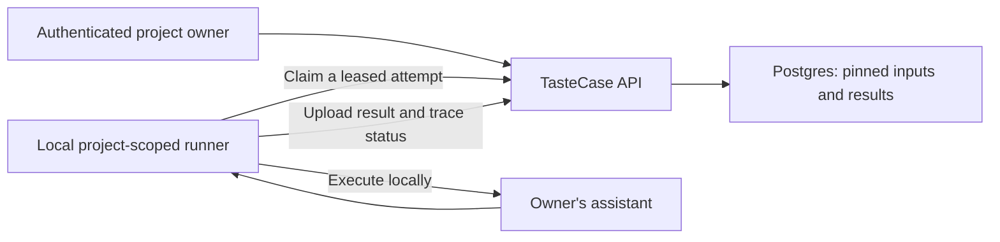

# TasteCase

**Find overlooked dining recommendation cases and turn reviewed findings into tests your AI concierge can replay before a release.**

TasteCase is for the engineering and QA team, not the traveler. It tests recommendations against the team's own restaurant catalog. Qloo helps identify cultural contrasts worth investigating; a human decides which findings deserve an expectation.

## What works today

This is the first backend-and-runner build. It has owned projects, immutable catalog/task versions, mapping confirmations, scoped runner credentials, leased target attempts and saved results. The local runner can execute an actual Nova Micro request and upload the result. It keeps target-provider credentials on the runner machine.

There is **no frontend or hosted demo yet**. Qloo discovery, human review, suites, comparisons and replay are still to be built. The earlier Qloo/MCP experiment established a small live contrast, not an advantage over generic test generation. Visual design is deferred.

## How the foundation works



1. The owner creates a project and immutable catalog/task versions.
2. The owner confirms mappings and queues an attempt with pinned inputs.
3. A scoped runner claims one attempt and calls its locally configured adapter.
4. The API stores the result and checksum. Identical upload retries are accepted; conflicting results and stale leases are rejected.
5. Revoking the runner credential stops new claims and uploads.

Missing cultural evidence is not a negative preference. An incomplete trace cannot prove an integrity violation. A taste-ranking change is advisory, not an automatic failure.

## Tools and their role

| Tool | Role | Current state |
|---|---|---|
| Qloo official MCP | Find cultural contrasts within eligible restaurant options | Verified in a private integration experiment; discovery worker not yet in this repository |
| LiteLLM / Nova Micro | Initial testing-agent choice and local sample target adapter | Real target request verified through the runner |
| Supabase | Owner authentication, Postgres and private storage | Auth verifier and compatible migrations implemented; hosted account/storage flow not verified |
| Fastify / Node | Persistent API and future discovery worker | Local API implemented and tested |
| Vercel / Render | Planned web and persistent backend hosting | Not deployed |

## Local setup

Use Node **24.21.0** and PostgreSQL **17**. Install dependencies and build:

```sh
npm install --ignore-scripts
npm run build
```

Set `DATABASE_URL`, `SUPABASE_URL`, `SUPABASE_ANON_KEY` and optionally `PORT` in the API environment; names and local defaults are in [.env.example](.env.example). The API does not automatically load that file. Use a dedicated database, never an unrelated product's database.

Apply migrations and start the API:

```sh
npm run db:migrate
npm run dev:api
```

The API currently binds to loopback only. Production owner requests are verified through Supabase Auth, not decoded JWT claims or caller-supplied owner IDs. The database connection needs the privileged migration/runtime permissions documented in [the runner guide](docs/runner.md).

For a **vanilla local test database named `tastecase_test` only**, explicitly opt into the local auth shim:

```sh
npm run db:migrate -- --local-test-bootstrap
```

Never use the local bootstrap on a hosted Supabase database.

## Checks and live runner verification

With `DATABASE_URL` pointing to local `tastecase_test`:

```sh
npm run check
```

This runs lint, strict type checks, builds, unit tests and real Postgres isolation/concurrency tests. Without `DATABASE_URL`, database suites are explicitly skipped; that is not a database pass. CI supplies PostgreSQL 17 and needs no model credentials.

An opt-in live check uses a labeled synthetic catalog and **one billed model call**:

```sh
TASTECASE_LIVE_VERIFY=1 npm run verify:runner
```

It requires local `DATABASE_URL` and local `LITELLM_API_KEY`. It uses a synthetic owner verifier on a temporary loopback API, **not hosted Supabase login**. It verifies handshake, claim, real target execution, upload, checksum and reading the saved result from a fresh API instance. Proof metadata stays in ignored `.local/` storage; no keys or target text are printed.

See [runner setup and adapter contract](docs/runner.md) and [security boundaries](SECURITY.md).

## Remaining work

- Hosted Supabase login and actual private-object storage verification.
- Bounded Qloo discovery with coverage checks, checkpoints and recovery.
- Human review, immutable suites, comparison, export and pinned replay.
- Owner-approved frontend and in-app documentation.
- Hosted sample, judge access and a measured case-yield comparison.

The Qloo experiment's upstream dependency advisories must be resolved before adding that integration to a public backend. They are not included in this foundation's dependencies.

## Repository

- `apps/api`: owner API, runner endpoints and migration CLI.
- `packages/contracts`: shared validation, pinned inputs and checksums.
- `packages/runner`: local runtime, CLI and LiteLLM sample adapter.
- `supabase`: migrations and database-invariant tests.
- `scripts`: opt-in live runner verification.

## License

[MIT](LICENSE).
