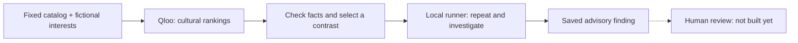
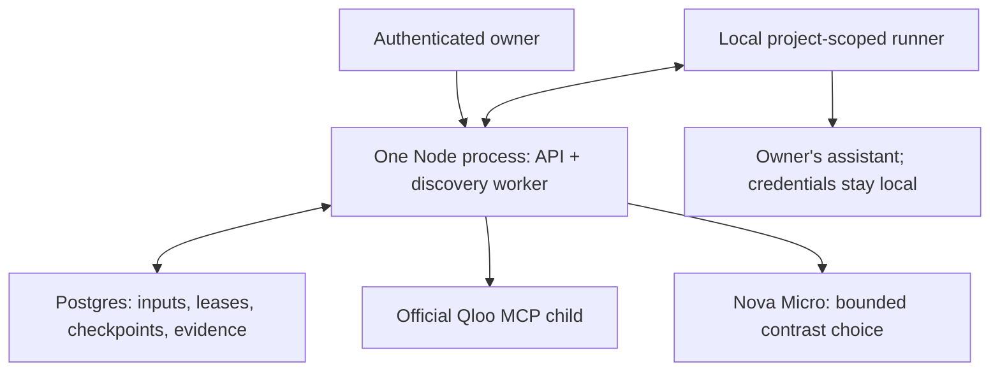

# TasteCase

**Find overlooked dining recommendation cases and turn reviewed findings into tests your AI concierge can replay before a release.**

TasteCase is for the engineering and QA team, not the traveler. It tests recommendations against the team's own restaurant catalog. Qloo helps identify cultural contrasts worth investigating; a human decides which findings deserve an expectation.

Live demo: not available · Video: not available · Docs: this README and [backend guide](docs/discovery.md) · Submission: not submitted

No product screenshots exist yet; frontend and visual design are deferred.

Built with: Qloo official MCP · Nova Micro · Supabase · Fastify / Node

**Status: private backend and runner, checked locally against live providers and hosted Supabase. No deployed app.**

## The problem

A prompt or model change can alter a concierge's restaurant choices while its answers still sound sensible. Format checks alone do not show which recommendation cases changed or whether the change deserves attention.

## What TasteCase does

The backend tests two fictional interest profiles against the same fixed restaurant catalog and practical constraints. Qloo guides cultural contrasts to investigate. Nova Micro selects a supported contrast, and an authorised local runner executes the assistant, repeats the case and runs a focused follow-up. TasteCase saves the evidence as an advisory finding for later human review.

Owned projects, immutable catalog/task inputs, mapping confirmations, scoped runner access, cancellation and restart recovery are implemented. **Human review, published suites, comparisons, export and replay are not built yet.**

## How it works

1. The owner creates a project, pins restaurant/task versions and confirms public Qloo mappings.
2. A bounded discovery job ranks the same eligible options for two explicit synthetic profiles.
3. Code checks coverage and ranking changes. Nova Micro chooses only from those observed contrasts.
4. A project-scoped runner calls the owner's locally configured assistant. Its credentials never go to the backend.
5. Repeats and a smaller Qloo comparison investigate the selected pair without changing practical constraints or the target's eligible catalog.
6. Immutable evidence and checksums survive restart. A saved taste finding still requires human approval; it is not a failed test.



## Why Qloo matters

Qloo supplies cross-interest ranking evidence for the team's own eligible restaurant options. That determines which paired briefs and follow-ups the backend investigates, rather than asking an LLM to invent a taste contrast. A small live order reversal has been preserved in a two-item follow-up. **Better useful-case yield than generic generation remains unproven.**

Missing cultural evidence is not a negative preference. An incomplete trace cannot prove an integrity violation. A taste-ranking change is advisory, not an automatic failure.

## Try it

There is no hosted judge path yet. Run the local checks below and inspect the [discovery API and recovery guide](docs/discovery.md). Live checks require your own authorised credentials and incur provider usage; CI uses synthetic fixtures instead.

## Product / demo

The current product surface is an owner-authenticated API plus a local runner CLI. No frontend, screenshot, demo video or public sample has been shipped.

## Architecture



## Integration details

| Tool | Role | Current state |
|---|---|---|
| Qloo official MCP | Resolve public anchors and rank the fixed eligible options | Integrated worker, live full/reduced rankings and missing-coverage handling verified |
| LiteLLM / Nova Micro | Choose a code-verified contrast; sample runner target | Live decision and six real target calls verified; unsupported model output is rejected |
| Supabase | Owner authentication, Postgres and private storage | Dedicated free-plan database, migrations, real owner/RLS and private-object isolation verified |
| Fastify / Node | One API/worker process with a Postgres-backed queue | Local startup, readiness, cancellation and restart tests pass |
| Vercel / Render | Planned web and persistent backend hosting | Not deployed |

## What's running

A dedicated Supabase project holds the private database and Auth/Storage configuration. The API, discovery worker and runner have run on loopback for verification; they are **not publicly hosted**. Qloo uses its [hackathon API](https://hackathon.api.qloo.com), through `@qloo/qloo-harness@0.1.26`; the model is `nova-micro` through LiteLLM.

## Evidence

Verified on 2026-10-13:

- `npm run check`: lint, strict types, builds and **235 passing tests**, including real Postgres tests; zero skipped.
- Live discovery: four accepted Qloo ranking calls, one validated Nova decision and six real target calls through the runner. A worker restart reused saved checkpoints and checksums. One advisory candidate was saved.
- Full live rankings returned **2 of 3** mapped restaurants for both profiles. Reduced pair rankings returned **2 of 2**. The final state stayed **partial** because coverage and traces were incomplete.
- Hosted foundation: **61 checks** for real sign-in, project/runner isolation and private Storage. Hosted discovery: **28 checks** for schema readiness, real sign-in, queue/reopen/cancel, owner isolation and backend-only RPC permissions. Both discovery migrations applied once; a repeat applied zero.

Proof metadata remains in ignored local storage, not in published provider-response fixtures. Earlier attempts also preserved rate limits, rejected malformed output and recorded a valid no-useful-contrast result; the successful run does not erase those limits.

## Failure cases / what we tested

| Attempt | Expected behaviour | Result |
|---|---|---|
| Read or cancel another owner's discovery job | 404; no private data exposed | Local tests and real hosted Auth/RLS checks passed |
| Repeat an accepted upload with different content | Visible conflict; preserve original result | Database and API tests passed |
| Restart after dispatch or lose a lease | Reuse accepted evidence; label unknown work uncertain, without refunding budgets | Recovery and two-connection tests passed |
| Cancel a job | Stop new claims; retain valid already-dispatched uploads | API/worker/database tests passed |
| Qloo omits an option or returns an error | Unavailable coverage, not disliked and not a taste failure | Live partial/error outcomes and adapter tests passed |
| Model invents a contrast ID or adds claims | Reject it instead of persisting a verdict | Adapter tests passed |

## Repository structure

- `apps/api`: owner/runner/discovery routes, single-process backend and migration CLI.
- `apps/worker`: guarded MCP/model adapters, bounded investigations and recovery.
- `packages/contracts`: shared validation, pinned inputs and checksums.
- `packages/runner`: local runtime, CLI and LiteLLM sample adapter.
- `supabase`: migrations and database-invariant tests.
- `scripts`: opt-in live runner/discovery verification.

## Run locally

Use Node **24.21.0** and PostgreSQL **17**. Install dependencies and build:

```sh
npm install --ignore-scripts
npm run build
```

Set `DATABASE_URL`, `SUPABASE_URL`, `SUPABASE_ANON_KEY`, `QLOO_API_KEY` and `LiteLLM_API_KEY` in the backend environment; names and local defaults are in [.env.example](.env.example). The API does not automatically load that file. Use a dedicated database, never an unrelated product's database.

Apply migrations and start the API:

```sh
npm run db:migrate
npm start
```

For the dedicated hosted Supabase database, use its **actual session-pooler host** and `postgres.<project-ref>` username from Supabase, on port 5432. Set `DATABASE_URL` through the secret manager, never in this repository or a CLI argument. Require `sslmode=verify-full` in the connection string. The pooler uses Supabase's own CA, supplied here as the [public certificate](supabase/certs/prod-ca-2021.crt); from the repository root, before launching migration or API processes:

```sh
export NODE_EXTRA_CA_CERTS="$(pwd)/supabase/certs/prod-ca-2021.crt"
export DATABASE_SSL_CA_FILE="$(pwd)/supabase/certs/prod-ca-2021.crt"
```

For another deployment layout, use an absolute path to this certificate in the server environment. Do not disable TLS verification. The certificate was retrieved from [Supabase's published download](https://supabase-downloads.s3-ap-southeast-1.amazonaws.com/prod/ssl/prod-ca-2021.crt); refresh it if Supabase rotates its CA. On 2026-10-13, the hosted migration was applied once and a repeat run applied zero migrations. The storage bucket is private; two real synthetic Supabase Auth owners could access only their own records, and cross-project/unauthenticated object reads were denied. The synthetic accounts and uploaded object were removed; labeled, isolated immutable test records remain. This was a loopback API against hosted services, **not a deployed TasteCase application**.

The backend binds to loopback by default. Set an explicit `HOST` only when configuring hosting. Production owner requests are verified through Supabase Auth, not decoded JWT claims or caller-supplied owner IDs. The database connection needs the privileged migration/runtime permissions documented in [the runner guide](docs/runner.md).

For a **vanilla local test database named `tastecase_test` only**, explicitly opt into the local auth shim:

```sh
npm run db:migrate -- --local-test-bootstrap
```

Never use the local bootstrap on a hosted Supabase database.

## Checks and live runner verification

With `DATABASE_URL` pointing to local `tastecase_test`:

```sh
npm run check
```

This runs lint, strict type checks, builds, unit tests and real Postgres isolation/concurrency tests. Without `DATABASE_URL`, database suites are explicitly skipped; that is not a database pass. CI supplies PostgreSQL 17 and needs no model credentials.

An opt-in live check uses a labeled synthetic catalog and **one billed model call**:

```sh
TASTECASE_LIVE_VERIFY=1 npm run verify:runner
```

It requires local `DATABASE_URL` and local `LITELLM_API_KEY`. It uses a synthetic owner verifier on a temporary loopback API, **not hosted Supabase login**. It verifies handshake, claim, real target execution, upload, checksum and reading the saved result from a fresh API instance. Proof metadata stays in ignored `.local/` storage; no keys or target text are printed.

See [runner setup and adapter contract](docs/runner.md) and [security boundaries](SECURITY.md).

For the bounded Qloo → Nova → runner check, see [live discovery verification](docs/discovery.md#live-verification). It uses private public-entity fixtures and never commits raw provider replies.

## Limitations

- The official Qloo harness/Pi dependency chain currently has **four audit findings: two moderate and two high**. They remain unresolved and block public hosting; `npm audit` does not pass.
- The ranking workflow accepts at most ten mapped options. Larger inputs are explicitly unsupported, not silently split into incomparable scores.
- Nova's prose is not authoritative. Only validated choices and code-computed evidence enter the finding.
- Provider dispatch and billing are not exactly-once; unknown outcomes stay visible and charged.
- No frontend, deployed backend, review/suite/comparison/export/replay flow or measured advantage over generic generation exists yet.

## Roadmap

- Deploy the API and verify its hosted operational and session-recovery paths.
- Human review, immutable suites, comparison, export and pinned replay.
- Owner-approved frontend and in-app documentation.
- Hosted sample, judge access and a measured case-yield comparison.

## License

[MIT](LICENSE).
