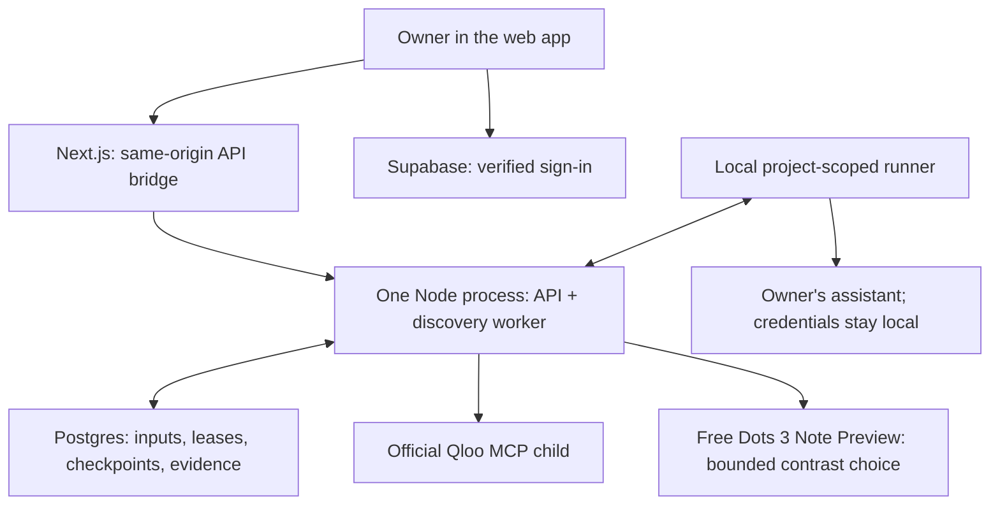

# TasteCase

**Release testing for AI assistants that recommend restaurants.**

Say your team runs an AI concierge that suggests restaurants from your own list. You change the prompt or switch models, and the answers still read fine. But did it quietly stop suggesting the live-jazz soul food spot to the guest who loves music? Format checks won't tell you.

TasteCase finds cases like that and turns the ones that matter into tests:

1. Qloo's taste data ranks your restaurants for two fictional guests with different interests, such as a Radiohead fan and a fan of *The Grand Budapest Hotel*. Where their rankings flip, there's a case worth checking.
2. TasteCase runs your assistant on that case and repeats it. The review card shows what Qloo saw: affinity scores, which interests mattered, and each restaurant's cuisine and ambience tags.
3. A person on your team approves, edits or rejects the case. Qloo's ranking is evidence to look at, never an automatic pass or fail.
4. Approved cases go into a frozen test suite. Before a release, you run two versions of your assistant against it and compare the results.

TasteCase is built for the engineering and QA team, not for diners. Your assistant runs on your own machine through a local runner, so its model keys never reach TasteCase.

Live app: [tastecase.vercel.app](https://tastecase.vercel.app) · [In-app docs](https://tastecase.vercel.app/docs) · Built for the [Qloo Agentic Hackathon](https://qloo.devpost.com/)

Built with: Qloo official MCP · Dots 3 Note Preview (OpenRouter free selector) · NVIDIA Nemotron 3.5 Super VL (default local runner target) · Supabase · Fastify / Node · Next.js / React Aria Components

**Status: hosted web app, private projects, backend, local runner and a read-only [public sample](https://tastecase.vercel.app/sample).**


## How it works

1. You create a project with your restaurant catalog and the task your assistant handles. You confirm which Qloo entity each restaurant and each fictional guest interest maps to.
2. A discovery job asks Qloo to rank the same restaurants for two fictional guests. Code finds the pairs whose order flips between the guests and records where Qloo has no coverage.
3. A free model picks one flipped pair to investigate. It can only choose from pairs the code already found, so it can't invent a contrast.
4. Your local runner sends each guest's request to your assistant, repeats it and runs a smaller follow-up ranking on the chosen pair. Your assistant's keys stay on your machine.
5. The finding lands on a review card with Qloo's signals. You accept, edit, reject or defer it with a reason. Taste findings stay advisory. Only explicit rules you add can pass or fail.
6. You publish approved cases as a suite. It's frozen, so later edits or results don't change it.
7. You run two versions of your assistant against the suite and compare them. Rule results, advisory findings and unavailable results are reported separately.
8. You freeze the report, download the test pack and replay it locally without calling Qloo again.


## How TasteCase uses Qloo

TasteCase runs Qloo's official MCP harness (`@qloo/qloo-harness@0.1.26`) as a child process and uses its `qloo_describe` and `qloo_rank` tools.

- Identity: each restaurant and guest interest is mapped to a Qloo entity with `qloo_describe`, and the owner confirms the match. Rankings then use those IDs.
- Ranking: `qloo_rank` calls `/v2/insights` with a guest's interests as signals and the team's own restaurants as the candidates. The flips between two guests' rankings decide which cases get investigated, so the cases come from Qloo's data, not from an LLM making up a contrast.
- Explanations: rankings request `feature.explainability`, and TasteCase keeps the place tags Qloo already returns from `/entities`. Review cards show each restaurant's affinity score, the gap between the two, how much each interest contributed, and cuisine, genre, category, ambience and culinary-style tags, with the tags only one side has marked. None of this adds a request.
- Rate limits: entity lookups are batched into one request and cached in memory for 15 minutes. A ranking makes at most two HTTP requests, never retries a 429 and waits at least 250ms between requests, under the 5 requests/second limit Qloo support gave us.
- Meaning: missing coverage means no evidence, not a dislike. A ranking change is something for a person to look at, not an automatic failure, and Qloo never decides whether a recommendation is good.

What we learned building on Qloo's tools, including suggestions for the harness, is in [FEEDBACK.md](FEEDBACK.md).

## Try it

Start with [Inspect a case](https://tastecase.vercel.app/sample), a saved example you can read without an account or model key. Its diners are fictional; the Qloo rankings and assistant answers came from a real run. Reading it makes no new provider calls. To test your own assistant, sign in to the [hosted app](https://tastecase.vercel.app) and connect your local runner. See the [in-app docs](https://tastecase.vercel.app/docs) for the steps. Live runs need authorised credentials and provider allowance; CI uses synthetic fixtures instead.

## For judges

- Without an account: the [public sample](https://tastecase.vercel.app/sample) shows one saved case with real Qloo rankings and assistant answers for fictional diners, and the [in-app docs](https://tastecase.vercel.app/docs). Neither makes provider calls.
- Full live run: sign up on the hosted app, create a project, issue a runner token, and run the local runner (`packages/runner`, see [docs/runner.md](docs/runner.md)) with your own free OpenRouter key. Qloo calls run on our backend with our hackathon key. Your assistant credentials stay on your machine.
- The API runs on Render's free tier and sleeps when idle, so the first request after a pause can take up to about a minute.
- Code: `apps/worker/src/qloo-http.ts` contains the bounded Qloo transport (`minimumDispatchGapMs`); `apps/worker/src/qloo-mcp.ts` and `apps/worker/src/qloo.ts` wire the `qloo_rank` tool and calls. Contrast selection is in `apps/worker/src/decision.ts`. Feedback on Qloo's tools is in [FEEDBACK.md](FEEDBACK.md).
- Signup was checked on production on 2026-10-25 with a fresh account. It needs email confirmation, the confirmation email arrived in under half a minute, and its link signed the account in. Project setup and runner-token issue and revocation also worked.

## Product / demo

The product has a hosted web app, in-app docs (`/docs`), an owner-authenticated API and a local runner CLI. The web transport is tested against the real API and local database, including review, publication, comparison and downloads. The public sample shows one recorded case, not an interactive run of every product step.

## Architecture



## Integration details

| Tool | Role | Current state |
|---|---|---|
| Qloo official MCP | Resolve public anchors, rank the fixed eligible options and explain rankings with affinity, interest influence and place tags | Integrated worker; live rankings, explainability, tags and missing-coverage handling verified; review-card signals checked with synthetic fixtures |
| OpenRouter / Dots 3 Note Preview (free) | Choose a code-verified contrast | 2026-10-26 selector check, see Evidence |
| OpenRouter / NVIDIA Nemotron 3.5 Super VL (free) | Default local runner target | Bounded live pilot completed 2026-10-25; reasoning disabled for this model |
| Supabase | Owner authentication, Postgres and private storage | Dedicated free-plan database, migrations, real owner/RLS and private-object isolation verified |
| Next.js / React Aria Components | Web workbench, in-app docs and bounded API bridge | Manrope selected; component and local HTTP/database checks pass; real-provider browser journey verified |
| Fastify / Node | One API/worker process with a Postgres-backed queue | Local startup, readiness, cancellation and restart tests pass |
| Vercel / Render | Frontend and a combined API/discovery worker | Deployed on Vercel Hobby and one Render free web service; sleep and shared quotas apply |

## What's running

A dedicated Supabase project holds the private database and Auth/Storage configuration. The frontend is at [tastecase.vercel.app](https://tastecase.vercel.app); the API and discovery worker share [tastecase-api.onrender.com](https://tastecase-api.onrender.com). See the [deployment guide](docs/deployment.md) for exact settings and limitations. Qloo uses its [hackathon API](https://hackathon.api.qloo.com) through `@qloo/qloo-harness@0.1.26`. The discovery selector uses `dots-studio/dots-3-note-preview:free` and the default local runner target is `nvidia/nemotron-3.5-super-vl:free`, both through OpenRouter's free route. Earlier Nemotron selector evidence below is historical and describes a prior selector, not the current Dots selector.

## Evidence

Selector model check (2026-10-26): each free model got the same 5 selector requests, using the worker's real request settings, with 1 to 21 code-verified contrasts and partial Qloo coverage. Dots 3 Note Preview returned valid selections 5 of 5 at $0. Xing 4.0 returned 2 of 5, with three HTTP 429s from its single provider. Nemotron 3.5 Super VL returned 2 of 5, with three HTTP 502s. Every valid answer picked the first listed contrast. Dots is a preview model, and one small check is not proof of long-run reliability. The 50-request daily free cap applies to all free models together.

Historical bounded discovery pilot with NVIDIA Nemotron 3.5 Super VL as selector (2026-10-25): three Qloo ranking workflows made six HTTP requests, all returning 200, spaced at least 250 ms apart. Twelve free model calls (three guided selections, three generic selections, six target calls) reported $0, with no retries or provider fallbacks. The guided selector chose a case in two of three trials and the generic selector abstained in all three, producing two blinded review cards. Two earlier attempts the same day stopped cleanly: one on a provider `MODEL_UNAVAILABLE`, and one on an empty answer after low-effort reasoning used about 760 of 771 output tokens, which led to disabling reasoning. This showed the pipeline ran on that model. It doesn't show that the cases are useful.

First card review (2026-10-26): the owner reviewed the seven blinded cards from this run and the 2026-10-20 MiniMax run, and marked all seven useful, four chosen by the guided selector and three by the generic one. The review didn't separate the methods. Its reasons mostly described the assistant's uneven personalization across guests, which every card in a run shared. See the [pilot review](docs/discovery-pilot.md#first-review-2026-10-26) for counts and limits.

Qloo rate-limit fix (2026-10-25): Qloo support reported a 5 requests/second hackathon limit. TasteCase now batches entity lookups, makes at most two HTTP requests per workflow, disables hidden retries and spaces dispatches by 250 ms.

Qloo signals on review cards (2026-10-25): a 2-request live probe confirmed explainability and place tags on the hackathon API. The card section was checked with synthetic fixtures at desktop and phone widths. A hosted synthetic discovery run on 2026-10-25 then produced the first public sample with these signals: 8 Qloo requests, all HTTP 200, 7 free Nemotron calls and 4 rank evidence rows with affinity and interest influence, plus 108 place tags. One of six assistant attempts timed out and is shown as a gap. Two earlier hosted attempts that day stopped on a Qloo step with `PROVIDER_INVALID_DATA`, and the cause is not yet known. The worker now logs a safe description of that failure.

Current public sample (2026-10-26): case `9f97ffcd` from an 8-restaurant varied catalog contrasts Dirt Candy and Momofuku Noodle Bar. Its run made 8 Qloo requests, all HTTP 200, and 1 Dots selector call, and all 6 Nemotron answers came back. The owner reviewed and accepted it. The job is `partial` because one catalog restaurant has no Qloo match. Its two follow-up answers came from the wording that listed the pair in profile a's Qloo order, which [PR #22](https://github.com/CryptoZephyr/tastecase/pull/22) changed to catalog order. A rerun after that change timed out on two of the Taylor Swift guest's answers at 120 seconds, and the owner rejected it, so the sample stays on `9f97ffcd`.

<details>
<summary>Earlier verification (Oct 13 to 14, historical)</summary>

Hosted browser verification (2026-10-14): genuine Qloo/Nemotron discovery, advisory review, immutable suite publication, a complete **8/8** comparison, frozen report/pack downloads and reopening through the deployed services. **One hosted decision plus ten local assistant requests; the ten local responses reported $0. Four Qloo calls; no model retries or paid fallback.** A transient session-verification timeout recovered with the visible retry; its cause was not established. The downloaded hosted pack was not replayed in this run. The pre-deployment replay evidence below remains separate.

Pre-deployment Nemotron verification (2026-10-14): **667 tests**, lint, types, production build and CI passed; dependency audit was clean. The real browser completed discovery, advisory review, exact suite publication, four comparison executions, frozen report/pack downloads and reopening. The browser-downloaded pack replayed through both distinct local prompt bindings on the same model. Total: **11 model requests reporting $0, four Qloo calls, zero retries or paid fallback**. The deployment-docs and runner-instructions branch also passed all **668 tests**, lint, types and production build.

Missing Qloo coverage and partial traces stayed visible. Recommendation ordering was unchanged; all selected outcomes stayed advisory, not automatic correctness passes or proof of better case yield. That pre-deployment verification did not provision an anonymous sample or deploy the app.

Earlier verification on 2026-10-13 (Nova evidence is historical):

- `npm run check`: lint, strict types, builds and **473 passing tests**, including a fresh PostgreSQL 17 CI-mode run; zero skipped.
- Frontend wiring follow-up: **658 passing tests**, lint, strict types and production build. Six cross-layer tests exercise the real loopback API, proxy, transport and PostgreSQL; provider evidence in those tests is explicitly simulated, not a public sample. Production checks exclude dev fixtures and inspect browser import/secret boundaries.
- Runner-handshake migration applied to dedicated hosted Supabase; repeat applied zero. Handshake timestamps record a verified past request, not a continuous connection guarantee.
- Hosted wiring follow-up: **34 checks passed** using the production Auth driver, HTTP transport and proxy with real Supabase password sign-in, owner isolation, handshake/revocation and sign-out/account-change fencing. Both disposable Auth accounts were deleted; isolated synthetic history remains. This used a loopback API, not a hosted web app or browser test, and made no provider calls.
- Live discovery: four accepted Qloo ranking calls, one validated Nova decision and six real target calls through the runner. A worker restart reused saved checkpoints and checksums. One advisory candidate was saved.
- Full live rankings returned **2 of 3** mapped restaurants for both profiles. Reduced pair rankings returned **2 of 2**. The final state stayed **partial** because coverage and traces were incomplete.
- Hosted foundation: **61 checks** for real sign-in, project/runner isolation and private Storage. Hosted discovery: **28 checks** for schema readiness, real sign-in, queue/reopen/cancel, owner isolation and backend-only RPC permissions. Both discovery migrations applied once; a repeat applied zero.
- Review/suites: API, SQL and contract tests cover concurrent edits, exact approval selection, atomic multi-case publication, same-ID retries and unchanged history after late uploads. Hosted review: **114 checks** through a loopback API with actual Supabase sign-in and synthetic evidence. The new migration applied once; a repeat applied zero. This did not call Qloo or a model, evaluate an assistant or establish a real human-approved taste verdict.
- Comparison/export/replay: **172 hosted checks** include real Auth, version-bound synthetic execution, private artifacts, immutable reports and review regression checks. The downloaded pack also replayed through **eight real Nova Micro calls**, with intentionally different local prompt configurations and advisory source cases. No Qloo calls or real-user taste verdicts were involved.

Proof metadata remains in ignored local storage, not in published provider-response fixtures. Earlier attempts also preserved rate limits, rejected malformed output and recorded a valid no-useful-contrast result; the successful run does not erase those limits.

</details>

## Failure cases / what we tested

| Attempt | Expected behaviour | Result |
|---|---|---|
| Read or cancel another owner's discovery job | 404; no private data exposed | Local tests and real hosted Auth/RLS checks passed |
| Repeat an accepted upload with different content | Visible conflict; preserve original result | Database and API tests passed |
| Restart after dispatch or lose a lease | Reuse accepted evidence; label unknown work uncertain, without refunding budgets | Recovery and two-connection tests passed |
| Cancel a job | Stop new claims; retain valid already-dispatched uploads | API/worker/database tests passed |
| Qloo omits an option or returns an error | Unavailable coverage, not disliked and not a taste failure | Live partial/error outcomes and adapter tests passed |
| Model invents a contrast ID or adds claims | Reject it instead of persisting a verdict | Adapter tests passed |
| Edit or publish from a stale revision | Visible conflict; do not overwrite newer approval | Concurrent API/SQL tests passed |
| Publish a mix of approved and unreviewed cases | Reject the whole publication; no partial suite | Local tests and hosted check passed |
| Edit/reject a case or upload a late result after publication | Preserve the suite and original review checksums | Local tests and hosted reopen check passed |

## Repository structure

- `apps/web`: Next.js web app and in-app docs. All API access goes through one typed port (`src/lib/api/port.ts`).
- `apps/api`: owner/runner/discovery/review/suite/comparison routes, single-process backend and migration CLI.
- `apps/worker`: guarded MCP/model adapters, bounded investigations and recovery.
- `packages/contracts`: shared validation, pinned inputs and checksums.
- `packages/runner`: local runtime, CLI, free-only Nemotron 3.5 Super VL adapter and explicit legacy OpenAI-compatible adapter.
- `supabase`: migrations and database-invariant tests.
- `scripts`: opt-in live runner/discovery verification.

## Run locally

Use Node **24.21.0** and PostgreSQL **17**. Install dependencies and build:

```sh
npm ci --ignore-scripts
npm run build
```

Set `DATABASE_URL`, `SUPABASE_URL`, `SUPABASE_ANON_KEY`, `QLOO_API_KEY` and `OPENROUTER_API_KEY` in the backend environment; names and local defaults are in [.env.example](.env.example). The API does not automatically load that file. Use a dedicated database, never an unrelated product's database.

Apply migrations and start the API:

```sh
npm run db:migrate
npm start
```

For the dedicated hosted Supabase database, use its **actual session-pooler host** and `postgres.<project-ref>` username from Supabase, on port 5432. Set `DATABASE_URL` through the secret manager, never in this repository or a CLI argument. Require `sslmode=verify-full` in the connection string. The pooler uses Supabase's own CA, supplied here as the [public certificate](supabase/certs/prod-ca-2021.crt); from the repository root, before launching migration or API processes:

```sh
export NODE_EXTRA_CA_CERTS="$(pwd)/supabase/certs/prod-ca-2021.crt"
export DATABASE_SSL_CA_FILE="$(pwd)/supabase/certs/prod-ca-2021.crt"
```

For another deployment layout, use an absolute path to this certificate in the server environment. Do not disable TLS verification. The certificate was retrieved from [Supabase's published download](https://supabase-downloads.s3-ap-southeast-1.amazonaws.com/prod/ssl/prod-ca-2021.crt); refresh it if Supabase rotates its CA. On 2026-10-13, the hosted migration was applied once and a repeat run applied zero migrations. The storage bucket is private; two real synthetic Supabase Auth owners could access only their own records, and cross-project/unauthenticated object reads were denied. The synthetic accounts and uploaded object were removed; labeled, isolated immutable test records remain. This was a loopback API against hosted services, **not a deployed TasteCase application**.

The backend binds to loopback by default. Set an explicit `HOST` only when configuring hosting. Production owner requests are verified through Supabase Auth, not decoded JWT claims or caller-supplied owner IDs. The database connection needs the privileged migration/runtime permissions documented in [the runner guide](docs/runner.md).

For a **vanilla local test database named `tastecase_test` only**, explicitly opt into the local auth shim:

```sh
npm run db:migrate -- --local-test-bootstrap
```

Never use the local bootstrap on a hosted Supabase database.

### Web app

Set these in the web process before building or starting it:

```sh
export TASTECASE_API_ORIGIN=http://127.0.0.1:3000
export NEXT_PUBLIC_SUPABASE_URL="${SUPABASE_URL}"
export NEXT_PUBLIC_SUPABASE_ANON_KEY="${SUPABASE_ANON_KEY}"
```

The public Supabase key must be a publishable/anon key, **never a service-role key**. `NEXT_PUBLIC_SUPABASE_PUBLISHABLE_KEY` is also supported. Next.js embeds public settings at build time; keep all database, Qloo and provider secrets in the API/runner environment, never in `NEXT_PUBLIC_*` variables. Allow the web origin's `/auth/callback` URL in Supabase Auth for signup and password recovery; PKCE links must be completed in the browser that requested them. Local development uses `http://localhost:3100/auth/callback`; configure the exact deployed origin separately before hosting.

```sh
npm run build --workspace @tastecase/contracts   # server proxy also validates receipts
npm run dev:web                                   # http://localhost:3100
```

The web app talks to the API through `apps/web/src/lib/api/port.ts`. Its HTTP transport sends verified owner Bearer tokens through `/api/tastecase/*`; the proxy permits only documented owner/public routes to one fixed backend origin. It does not proxy runner credentials, follow redirects or accept arbitrary destinations. Private screens hide during unknown/expired authentication and remount when the owner changes. Missing configuration and unavailable evidence remain explicit errors, not empty successes. In development, `/dev/states` shows clearly labelled synthetic fixtures; these routes are excluded from `next build`.

The [public sample](https://tastecase.vercel.app/sample) is configured on the hosted API using `TASTECASE_PUBLIC_SAMPLE_PROJECT_ID`, `TASTECASE_PUBLIC_SAMPLE_CASE_ID` and `TASTECASE_PUBLIC_SAMPLE_INPUTS_SYNTHETIC=true`. Other deployments return unavailable until all three are set. Select only a dedicated, reviewed synthetic project with genuine saved Qloo rankings, assistant answers and a review. The anonymous route accepts no selectors, strips private metadata and never starts provider work. Its response was verified through the API and Vercel proxy, including schema checks, hidden private fields, rejected selectors and rejected writes. A recorded sample is not live processing, and its source checksums are provenance references rather than checksums of the public display projection.

## Checks and live runner verification

With `DATABASE_URL` pointing to local `tastecase_test`:

```sh
npm run check
node --import tsx scripts/verify-web-build.ts
```

This runs lint, strict type checks, builds, unit tests and real Postgres isolation/concurrency tests. Set `DATABASE_URL` explicitly: some integration suites skip without it, while SQL suites default to the designated local database on port 55432. Skipped checks are not a database pass. CI supplies PostgreSQL 17 and needs no model credentials.

An opt-in live check uses a labeled synthetic catalog and **one billed model call**:

```sh
TASTECASE_LIVE_VERIFY=1 npm run verify:runner
```

It requires local `DATABASE_URL` and local `OPENROUTER_API_KEY`. It uses a synthetic owner verifier on a temporary loopback API, **not hosted Supabase login**. It verifies handshake, claim, real target execution, upload, checksum and reading the saved result from a fresh API instance. Proof metadata stays in ignored `.local/` storage; no keys or target text are printed.

See [runner setup and adapter contract](docs/runner.md) and [security boundaries](SECURITY.md).

For the bounded Qloo → free model → runner check, see [live discovery verification](docs/discovery.md#live-verification). It uses private public-entity fixtures and never commits raw provider replies.

## Limitations

- The free OpenRouter route can be rate-limited or delisted without notice, as happened to the earlier MiniMax and Gemma free routes. TasteCase stops cleanly and never falls back to a paid model.
- The ranking workflow accepts at most ten mapped options. Larger inputs are explicitly unsupported, not silently split into incomparable scores.
- Model prose is not authoritative. Only validated choices and code-computed evidence enter the finding.
- Provider dispatch and billing are not exactly-once; unknown outcomes stay visible and charged.
- Comparisons support up to ten explicitly selected cases and only the reviewed declarative rules. Published advisory expectations remain non-automatic. Release labels are local attestations, not proof of model identity; self-checksums are not artifact signatures.
- The hosted real-provider browser journey and a fresh production signup with email confirmation passed. On 2026-10-25 the synthetic API cold start, service restart, queued-comparison cancellation and discovery cancellation were verified. A downloaded comparison pack passed its checksum check and replay made no Qloo calls. The first replay got 1 usable answer of 8 from the free model. A rerun with the runner's bounded retries got 5 of 8, baseline 3 of 4 and candidate 2 of 4, and the rest stayed unavailable after HTTP 502s or 429s. Objective-rule browser failures remain untested.
- One owner review of seven pilot cards rated every card from both methods useful, so there's still no evidence that Qloo-guided discovery finds more useful cases than ordinary generation.

## Roadmap

- Verify objective-rule browser failures in the hosted browser journey.
- Find the cause of the intermittent hosted `PROVIDER_INVALID_DATA` on Qloo rank steps, and retry assistant answers that time out during discovery.
- Measure whether Qloo-guided discovery finds more useful cases than ordinary generation, with pair-specific assistant answers and more than one reviewer.

## License

[MIT](LICENSE).
