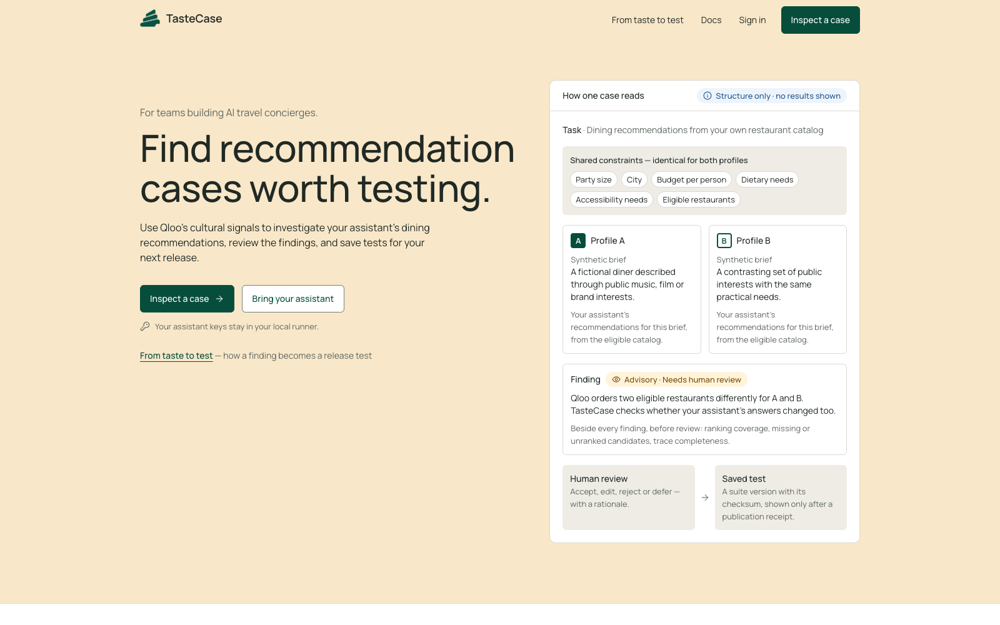

# TasteCase

**Find overlooked dining recommendation cases and turn reviewed findings into tests your AI concierge can replay before a release.**

TasteCase is for the engineering and QA team, not the traveler. It tests recommendations against the team's own restaurant catalog. Qloo helps identify cultural contrasts worth investigating; a human decides which findings deserve an expectation.

Live app: [tastecase.vercel.app](https://tastecase.vercel.app) · [In-app docs](https://tastecase.vercel.app/docs) · Video: not available · Submission: not submitted

The web app (`apps/web`) follows the owner-approved design and is connected through Supabase sign-in and a bounded, same-origin API bridge. The real-provider browser journey and downloaded-pack replay passed before deployment. The merged build is now hosted on Vercel and free Render. Recorded pre-deployment evidence is on [PR #3](https://github.com/CryptoZephyr/tastecase/pull/3).

Built with: Qloo official MCP · MiniMax M3.1 Flash (OpenRouter free) · Supabase · Fastify / Node · Next.js / React Aria Components

**Status: hosted web app, private projects, backend, local runner and a read-only [public sample](https://tastecase.vercel.app/sample). The repository stays private.**



## The problem

A prompt or model change can alter a concierge's restaurant choices while its answers still sound sensible. Format checks alone do not show which recommendation cases changed or whether the change deserves attention.

## What TasteCase does

The backend tests two fictional interest profiles against the same fixed restaurant catalog and practical constraints. Qloo guides cultural contrasts to investigate. Nemotron selects a supported contrast, and an authorised local runner executes the assistant, repeats the case and runs a focused follow-up. The owner can review the saved finding and publish approved expectation versions in a suite that later edits cannot change.

Owned projects, immutable inputs, scoped runner access, discovery/recovery, human review and immutable suites are implemented. Teams can compare two explicitly bound assistant versions, download a safe test pack/report and replay a selected version locally.

## How it works

1. The owner creates a project, pins restaurant/task versions and confirms public Qloo mappings.
2. A bounded discovery job ranks the same eligible options for two explicit synthetic profiles.
3. Code checks coverage and ranking changes. The free model chooses only from those observed contrasts.
4. A project-scoped runner calls the owner's locally configured assistant. Its credentials never go to the backend.
5. Repeats and a smaller Qloo comparison investigate the selected pair without changing practical constraints or the target's eligible catalog.
6. Immutable evidence and checksums survive restart. A saved taste finding still requires human approval; it is not a failed test.
7. The owner accepts, edits, rejects or defers a case with a rationale. Acceptance alone keeps the taste finding advisory; explicit policy or objective checks need a scoped expectation.
8. The owner publishes selected approved versions. The suite keeps its original evidence even after a later rejection, edit or runner result.
9. Two named assistant versions run fresh repeats against that suite. Approved rules, advisory findings and unavailable results stay separate.
10. The owner freezes the comparison report, exports the pinned pack and replays it locally without new Qloo calls.


## Why Qloo matters

Qloo supplies cross-interest ranking evidence for the team's own eligible restaurant options. That determines which paired briefs and follow-ups the backend investigates, rather than asking an LLM to invent a taste contrast. A small live order reversal has been preserved in a two-item follow-up. **Better useful-case yield than generic generation remains unproven.**

Missing cultural evidence is not a negative preference. An incomplete trace cannot prove an integrity violation. A taste-ranking change is advisory, not an automatic failure.

## Try it

Start with [Inspect a case](https://tastecase.vercel.app/sample), a saved example you can read without an account or model key. Its diners are fictional; the Qloo rankings and assistant answers came from a real run. Reading it makes no new provider calls. To test your own assistant, sign in to the [hosted app](https://tastecase.vercel.app) and connect your local runner. See the [in-app docs](https://tastecase.vercel.app/docs) for the steps. Live runs need authorised credentials and provider allowance; CI uses synthetic fixtures instead.

## Product / demo

The product has a hosted web app, in-app docs (`/docs`), an owner-authenticated API and a local runner CLI. The web transport is tested against the real API and local database, including review, publication, comparison and downloads. The public sample shows one recorded case, not an interactive run of every product step.

## Architecture


## Integration details

| Tool | Role | Current state |
|---|---|---|
| Qloo official MCP | Resolve public anchors and rank the fixed eligible options | Integrated worker, live full/reduced rankings and missing-coverage handling verified |
| OpenRouter / NVIDIA Nemotron 3 Super (free) | Choose a code-verified contrast; default local runner target | Browser journey and replay verified: 11 model calls reporting $0; no retry or paid fallback |
| Supabase | Owner authentication, Postgres and private storage | Dedicated free-plan database, migrations, real owner/RLS and private-object isolation verified |
| Next.js / React Aria Components | Web workbench, in-app docs and bounded API bridge | Manrope selected; component and local HTTP/database checks pass; real-provider browser journey verified |
| Fastify / Node | One API/worker process with a Postgres-backed queue | Local startup, readiness, cancellation and restart tests pass |
| Vercel / Render | Frontend and a combined API/discovery worker | Deployed on Vercel Hobby and one Render free web service; sleep and shared quotas apply |

## What's running

A dedicated Supabase project holds the private database and Auth/Storage configuration. The frontend is at [tastecase.vercel.app](https://tastecase.vercel.app); the API and discovery worker share [tastecase-api.onrender.com](https://tastecase-api.onrender.com). See the [deployment guide](docs/deployment.md) for exact settings and limitations. Qloo uses its [hackathon API](https://hackathon.api.qloo.com), through `@qloo/qloo-harness@0.1.26`; the current model is `minimax/minimax-m3.1-flash:free` through OpenRouter. Earlier Nemotron and Nova Micro evidence below is historical, not verification of the new route.

## Evidence

Hosted browser verification (2026-10-14): genuine Qloo/Nemotron discovery, advisory review, immutable suite publication, a complete **8/8** comparison, frozen report/pack downloads and reopening through the deployed services. **One hosted decision plus ten local assistant requests; the ten local responses reported $0. Four Qloo calls; no model retries or paid fallback.** A transient session-verification timeout recovered with the visible retry; its cause was not established. The downloaded hosted pack was not replayed in this run. The pre-deployment replay evidence below remains separate.

Pre-deployment Nemotron verification (2026-10-14): **667 tests**, lint, types, production build and CI passed; dependency audit was clean. The real browser completed discovery, advisory review, exact suite publication, four comparison executions, frozen report/pack downloads and reopening. The browser-downloaded pack replayed through both distinct local prompt bindings on the same model. Total: **11 model requests reporting $0, four Qloo calls, zero retries or paid fallback**. The deployment-docs and runner-instructions branch also passed all **668 tests**, lint, types and production build.

Missing Qloo coverage and partial traces stayed visible. Recommendation ordering was unchanged; all selected outcomes stayed advisory, not automatic correctness passes or proof of better case yield. That pre-deployment verification did not provision an anonymous sample or deploy the app.

Earlier verification on 2026-10-13 (Nova evidence is historical):

- `npm run check`: lint, strict types, builds and **473 passing tests**, including a fresh PostgreSQL 17 CI-mode run; zero skipped.
- Frontend wiring follow-up: **658 passing tests**, lint, strict types and production build. Six cross-layer tests exercise the real loopback API, proxy, transport and PostgreSQL; provider evidence in those tests is explicitly simulated, not a public sample. Production checks exclude dev fixtures and inspect browser import/secret boundaries.
- Runner-handshake migration applied to dedicated hosted Supabase; repeat applied zero. Handshake timestamps record a verified past request, not a continuous connection guarantee.
- Hosted wiring follow-up: **34 checks passed** using the production Auth driver, HTTP transport and proxy with real Supabase password sign-in, owner isolation, handshake/revocation and sign-out/account-change fencing. Both disposable Auth accounts were deleted; isolated synthetic history remains. This used a loopback API, not a hosted web app or browser test, and made no provider calls.
- Live discovery: four accepted Qloo ranking calls, one validated Nova decision and six real target calls through the runner. A worker restart reused saved checkpoints and checksums. One advisory candidate was saved.
- Full live rankings returned **2 of 3** mapped restaurants for both profiles. Reduced pair rankings returned **2 of 2**. The final state stayed **partial** because coverage and traces were incomplete.
- Hosted foundation: **61 checks** for real sign-in, project/runner isolation and private Storage. Hosted discovery: **28 checks** for schema readiness, real sign-in, queue/reopen/cancel, owner isolation and backend-only RPC permissions. Both discovery migrations applied once; a repeat applied zero.
- Review/suites: API, SQL and contract tests cover concurrent edits, exact approval selection, atomic multi-case publication, same-ID retries and unchanged history after late uploads. Hosted review: **114 checks** through a loopback API with actual Supabase sign-in and synthetic evidence. The new migration applied once; a repeat applied zero. This did not call Qloo or a model, evaluate an assistant or establish a real human-approved taste verdict.
- Comparison/export/replay: **172 hosted checks** include real Auth, version-bound synthetic execution, private artifacts, immutable reports and review regression checks. The downloaded pack also replayed through **eight real Nova Micro calls**, with intentionally different local prompt configurations and advisory source cases. No Qloo calls or real-user taste verdicts were involved.

Proof metadata remains in ignored local storage, not in published provider-response fixtures. Earlier attempts also preserved rate limits, rejected malformed output and recorded a valid no-useful-contrast result; the successful run does not erase those limits.

## Failure cases / what we tested

| Attempt | Expected behaviour | Result |
|---|---|---|
| Read or cancel another owner's discovery job | 404; no private data exposed | Local tests and real hosted Auth/RLS checks passed |
| Repeat an accepted upload with different content | Visible conflict; preserve original result | Database and API tests passed |
| Restart after dispatch or lose a lease | Reuse accepted evidence; label unknown work uncertain, without refunding budgets | Recovery and two-connection tests passed |
| Cancel a job | Stop new claims; retain valid already-dispatched uploads | API/worker/database tests passed |
| Qloo omits an option or returns an error | Unavailable coverage, not disliked and not a taste failure | Live partial/error outcomes and adapter tests passed |
| Model invents a contrast ID or adds claims | Reject it instead of persisting a verdict | Adapter tests passed |
| Edit or publish from a stale revision | Visible conflict; do not overwrite newer approval | Concurrent API/SQL tests passed |
| Publish a mix of approved and unreviewed cases | Reject the whole publication; no partial suite | Local tests and hosted check passed |
| Edit/reject a case or upload a late result after publication | Preserve the suite and original review checksums | Local tests and hosted reopen check passed |

## Repository structure

- `apps/web`: Next.js web app and in-app docs. All API access goes through one typed port (`src/lib/api/port.ts`).
- `apps/api`: owner/runner/discovery/review/suite/comparison routes, single-process backend and migration CLI.
- `apps/worker`: guarded MCP/model adapters, bounded investigations and recovery.
- `packages/contracts`: shared validation, pinned inputs and checksums.
- `packages/runner`: local runtime, CLI, free-only MiniMax adapter and explicit legacy OpenAI-compatible adapter.
- `supabase`: migrations and database-invariant tests.
- `scripts`: opt-in live runner/discovery verification.

## Run locally

Use Node **24.21.0** and PostgreSQL **17**. Install dependencies and build:

```sh
npm ci --ignore-scripts
npm run build
```

Set `DATABASE_URL`, `SUPABASE_URL`, `SUPABASE_ANON_KEY`, `QLOO_API_KEY` and `OPENROUTER_API_KEY` in the backend environment; names and local defaults are in [.env.example](.env.example). The API does not automatically load that file. Use a dedicated database, never an unrelated product's database.

Apply migrations and start the API:

```sh
npm run db:migrate
npm start
```

For the dedicated hosted Supabase database, use its **actual session-pooler host** and `postgres.<project-ref>` username from Supabase, on port 5432. Set `DATABASE_URL` through the secret manager, never in this repository or a CLI argument. Require `sslmode=verify-full` in the connection string. The pooler uses Supabase's own CA, supplied here as the [public certificate](supabase/certs/prod-ca-2021.crt); from the repository root, before launching migration or API processes:

```sh
export NODE_EXTRA_CA_CERTS="$(pwd)/supabase/certs/prod-ca-2021.crt"
export DATABASE_SSL_CA_FILE="$(pwd)/supabase/certs/prod-ca-2021.crt"
```

For another deployment layout, use an absolute path to this certificate in the server environment. Do not disable TLS verification. The certificate was retrieved from [Supabase's published download](https://supabase-downloads.s3-ap-southeast-1.amazonaws.com/prod/ssl/prod-ca-2021.crt); refresh it if Supabase rotates its CA. On 2026-10-13, the hosted migration was applied once and a repeat run applied zero migrations. The storage bucket is private; two real synthetic Supabase Auth owners could access only their own records, and cross-project/unauthenticated object reads were denied. The synthetic accounts and uploaded object were removed; labeled, isolated immutable test records remain. This was a loopback API against hosted services, **not a deployed TasteCase application**.

The backend binds to loopback by default. Set an explicit `HOST` only when configuring hosting. Production owner requests are verified through Supabase Auth, not decoded JWT claims or caller-supplied owner IDs. The database connection needs the privileged migration/runtime permissions documented in [the runner guide](docs/runner.md).

For a **vanilla local test database named `tastecase_test` only**, explicitly opt into the local auth shim:

```sh
npm run db:migrate -- --local-test-bootstrap
```

Never use the local bootstrap on a hosted Supabase database.

### Web app

Set these in the web process before building or starting it:

```sh
export TASTECASE_API_ORIGIN=http://127.0.0.1:3000
export NEXT_PUBLIC_SUPABASE_URL="${SUPABASE_URL}"
export NEXT_PUBLIC_SUPABASE_ANON_KEY="${SUPABASE_ANON_KEY}"
```

The public Supabase key must be a publishable/anon key, **never a service-role key**. `NEXT_PUBLIC_SUPABASE_PUBLISHABLE_KEY` is also supported. Next.js embeds public settings at build time; keep all database, Qloo and provider secrets in the API/runner environment, never in `NEXT_PUBLIC_*` variables. Allow the web origin's `/auth/callback` URL in Supabase Auth for signup and password recovery; PKCE links must be completed in the browser that requested them. Local development uses `http://localhost:3100/auth/callback`; configure the exact deployed origin separately before hosting.

```sh
npm run build --workspace @tastecase/contracts   # server proxy also validates receipts
npm run dev:web                                   # http://localhost:3100
```

The web app talks to the API through `apps/web/src/lib/api/port.ts`. Its HTTP transport sends verified owner Bearer tokens through `/api/tastecase/*`; the proxy permits only documented owner/public routes to one fixed backend origin. It does not proxy runner credentials, follow redirects or accept arbitrary destinations. Private screens hide during unknown/expired authentication and remount when the owner changes. Missing configuration and unavailable evidence remain explicit errors, not empty successes. In development, `/dev/states` shows clearly labelled synthetic fixtures; these routes are excluded from `next build`.

The [public sample](https://tastecase.vercel.app/sample) is configured on the hosted API using `TASTECASE_PUBLIC_SAMPLE_PROJECT_ID`, `TASTECASE_PUBLIC_SAMPLE_CASE_ID` and `TASTECASE_PUBLIC_SAMPLE_INPUTS_SYNTHETIC=true`. Other deployments return unavailable until all three are set. Select only a dedicated, reviewed synthetic project with genuine saved Qloo rankings, assistant answers and a review. The anonymous route accepts no selectors, strips private metadata and never starts provider work. Its response was verified through the API and Vercel proxy, including schema checks, hidden private fields, rejected selectors and rejected writes. A recorded sample is not live processing, and its source checksums are provenance references rather than checksums of the public display projection.

## Checks and live runner verification

With `DATABASE_URL` pointing to local `tastecase_test`:

```sh
npm run check
node --import tsx scripts/verify-web-build.ts
```

This runs lint, strict type checks, builds, unit tests and real Postgres isolation/concurrency tests. Set `DATABASE_URL` explicitly: some integration suites skip without it, while SQL suites default to the designated local database on port 55432. Skipped checks are not a database pass. CI supplies PostgreSQL 17 and needs no model credentials.

An opt-in live check uses a labeled synthetic catalog and **one billed model call**:

```sh
TASTECASE_LIVE_VERIFY=1 npm run verify:runner
```

It requires local `DATABASE_URL` and local `OPENROUTER_API_KEY`. It uses a synthetic owner verifier on a temporary loopback API, **not hosted Supabase login**. It verifies handshake, claim, real target execution, upload, checksum and reading the saved result from a fresh API instance. Proof metadata stays in ignored `.local/` storage; no keys or target text are printed.

See [runner setup and adapter contract](docs/runner.md) and [security boundaries](SECURITY.md).

For the bounded Qloo → Nova → runner check, see [live discovery verification](docs/discovery.md#live-verification). It uses private public-entity fixtures and never commits raw provider replies.

## Limitations

- The 2026-10-25 dependency refresh upgraded Next.js to 16.4.3, Zod to 4.6.7, Fastify to 5.12.7 and the worker MCP SDK to 1.32.2. The main-branch audit reported 9 vulnerabilities before the refresh; `npm audit` now reports zero. The lockfile resolves body-parser to 2.4.0, fast-uri to 3.1.9 and 4.2.3, and undici to 8.12.3 while retaining the Pi harness brace-expansion pin at 5.0.12. `npm run check` passed 512 tests, including 56 PostgreSQL checks, with zero skips. Keep the lockfile because upstream Pi publishes a shrinkwrap. See [dependency verification](docs/discovery.md#dependency-security).
- The ranking workflow accepts at most ten mapped options. Larger inputs are explicitly unsupported, not silently split into incomparable scores.
- Model prose is not authoritative. Only validated choices and code-computed evidence enter the finding.
- Provider dispatch and billing are not exactly-once; unknown outcomes stay visible and charged.
- Comparisons support up to ten explicitly selected cases and only the reviewed declarative rules. Published advisory expectations remain non-automatic. Release labels are local attestations, not proof of model identity; self-checksums are not artifact signatures.
- The hosted real-provider browser journey passed, and the recorded public sample passed API/proxy checks. Auth-email completion, deliberate cold-start recovery, live hosted cancellation/restart, objective-rule browser failures and replay of the newly downloaded hosted pack remain untested. A measured advantage over generic generation is not established.

## Roadmap

- Verify deliberate hosted cold-start recovery, cancellation and objective-rule failures.
- Verify Supabase signup/recovery email links and replay the newly downloaded hosted pack.
- Measure whether Qloo-guided discovery finds more useful cases than ordinary generation.

## License

[MIT](LICENSE).
